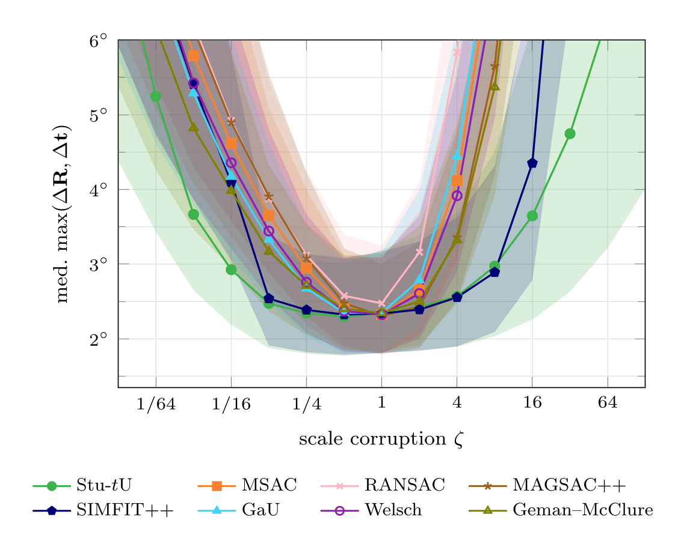
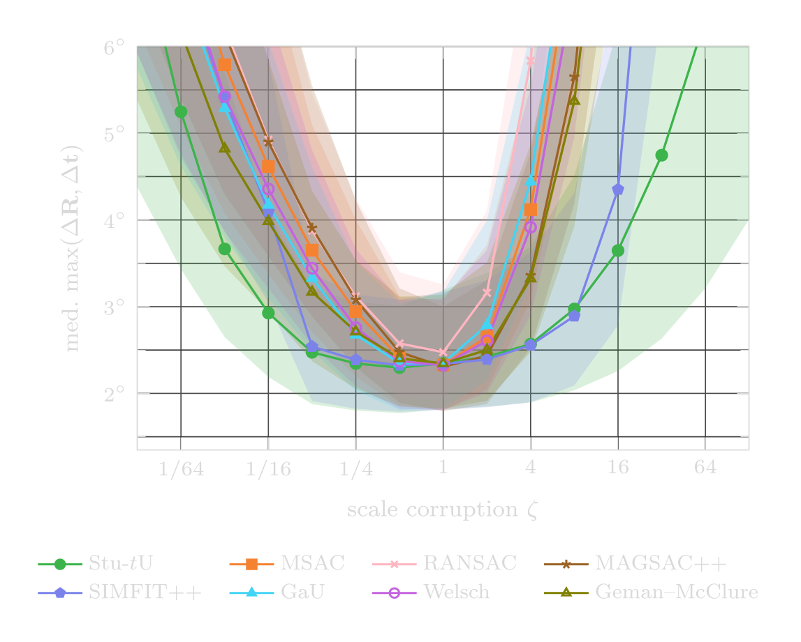
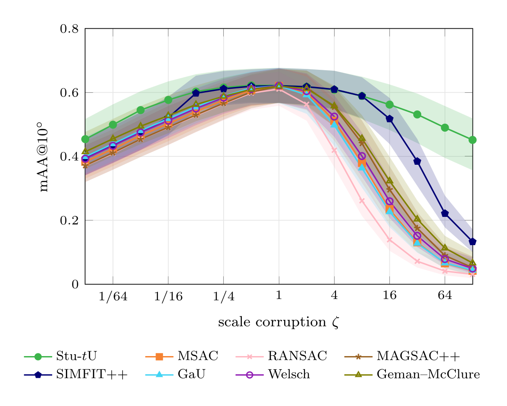
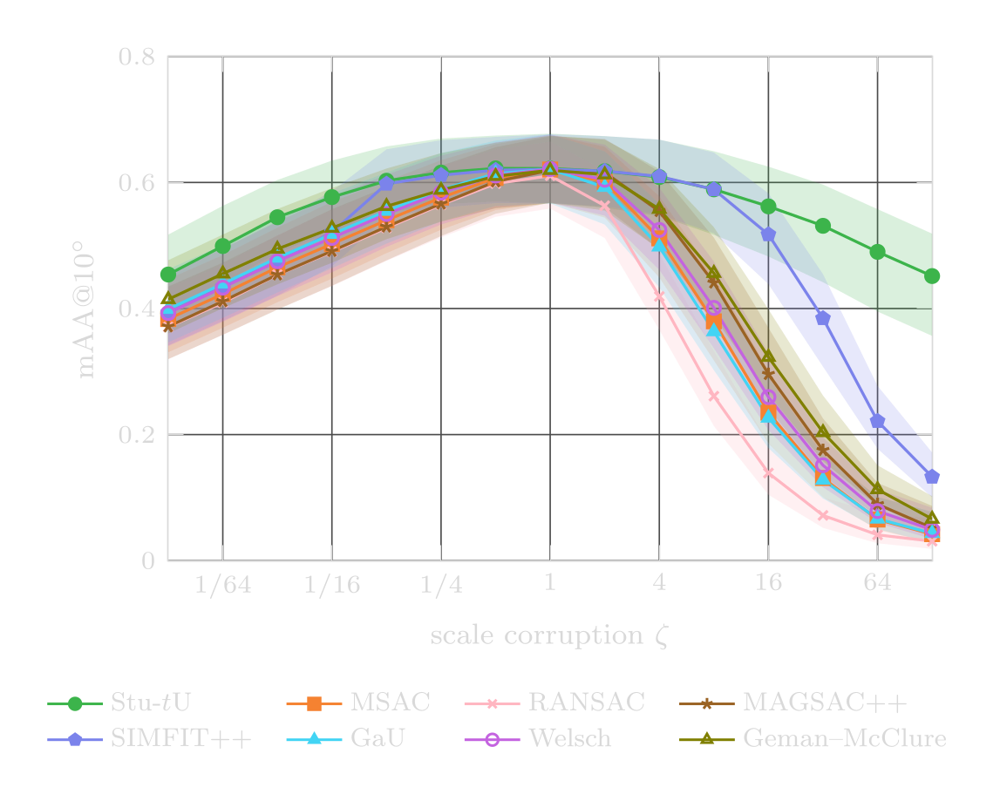

```@raw html
---
layout: home
hero:
  name: RANSAC Scoring Done Right
  text: Marginalize the Scale, Then Choose the Inliers
  tagline: |-
    James Pritts · Felix Seegräber · Kevin Köser
    Marine Data Science
    Kiel University
    NeurIPS 2026
  image:
    src: /assets/landing/hero_scoring_light.png
    dark: /assets/landing/hero_scoring_dark.png
    alt: A line model with noisy points; points the score selects as inliers are green, outliers red, with inliers drawn larger. Below, the residuals sorted ascending with the marginal score of every candidate partition, peaking at the selected inlier count.
  actions:
    - theme: brand
      text: Getting started
      link: "#Getting-started"
    - theme: alt
      text: API Reference
      link: /api/scoring/
    - theme: alt
      text: Paper
      link: https://arxiv.org/pdf/2606.27385
    - theme: alt
      text: Code (coming soon)
      link: "#Install"
features:
  - icon: 🎯
    title: Score a hypothesis
    details: "`StudentTUniformScoring` with `score!` (VisualGeometryCore's scoring contract) sorts a model's residuals and sweeps every partition: the score and the selected inlier count, with no threshold and no inlier scale."
    link: /api/scoring/
  - icon: 🗂️
    title: Select from a hypothesis pool
    details: "`best_pool_model` picks the best stored model of a benchmark pair under the marginal score or any loss-width baseline (RANSAC, MSAC, GaU, MAGSAC++), on the pair's residual matrix."
    link: /api/pools/
  - icon: ⚡
    title: Evaluate a width grid on CPU or GPU
    details: "`stage_ig_shared_from_pairs` stages a pool once; `grid_evaluate` scores it at every width of a grid with KernelAbstractions kernels on `CPU()` or CUDA."
    link: /api/pools/
  - icon: ⚖️
    title: Weight points for refinement
    details: "`consensus_s2` and `PosteriorWeightState` (VisualGeometryCore's toolkit) turn the selected partition into a scale estimate and Student-t posterior weights for local optimization."
    link: /api/posterior/
---
```

A closed-form RANSAC score in which the inlier scale is genuinely absent. The scale is marginalized under a conjugate inverse-gamma prior for each inlier partition, and the partition is optimized by sort-and-sweep in O(N log N).

### Scoring under scale miscalibration

```@raw html
<table class="sel-miscal">
<thead><tr><th style="text-align:center">Median pose error</th><th style="text-align:center">mAA@10°</th></tr></thead>
<tbody><tr>
<td style="text-align:center"></td>
<td style="text-align:center"></td>
</tr></tbody>
</table>
```

*Scoring under scale miscalibration, without local optimization (PhotoTourism
essential matrices; 11 test and 10 validation scenes). Each score's
hyperparameter is tuned at the correct scale and then evaluated with the scale
it is given multiplied by ζ, from 128 times too small to 128 times too large,
without retuning. Left: the scene-averaged median pose error, with the axis
clipped at 6° so the near-tied calibrated regime stays readable (the
threshold-based scores leave the panel under inflation and reach 33°–47° at
128×). Right: mAA@10° at the same operating points, which are tuned on the
median. Stu-tU is this package's scale-free marginal score. The baselines are
the Welsch and Geman–McClure scores, RANSAC, MSAC, MAGSAC++, the
Gaussian–uniform score (GaU) and SIMFIT++, which re-estimates the inlier
threshold per pair from held-out residuals of the hypothesis selected on a
random half of the correspondences. Shaded bands are scene-clustered BCa
bootstrap confidence intervals. From the supplement of
[Robust Local Optimization Done Right](https://localoptimizationdoneright.github.io/)
(ACCV 2026).*

### The method

The score marginalizes the inlier scale analytically and chooses the inlier set with
one sort-and-sweep over the residuals (paper, Algorithm 1).

```@raw html
<pre class="pseudocode">
\begin{algorithm}
\caption{Sort-and-sweep computation of the scale-free marginal score. The algorithm returns the best-scoring prefix $\mathcal{I}^* = \{(1),\ldots,(k^*)\}$ in $O(N\log N)$ time.}
\begin{algorithmic}
\REQUIRE per-point scores $q_1,\ldots,q_N$; codimension $d_g$; model parameters $n_\theta$; outlier half-width $a$; prior parameters $(\alpha_0, \beta_0)$
\ENSURE best score $S^*$; optimal inlier count $k^*$
\STATE Sort so that $q_{(1)} \leq q_{(2)} \leq \cdots \leq q_{(N)}$
\STATE $k_{\min} \gets \min\bigl(\lfloor n_\theta/d_g \rfloor,\, N\bigr)$ \COMMENT{largest prefix with $\nu \leq 0$}
\STATE $\mathrm{RSS} \gets \sum_{j=1}^{k_{\min}} q_{(j)}$ \COMMENT{seed the zero-DOF prefix}
\STATE $S^* \gets -\infty$, $\quad k^* \gets 0$
\FOR{$k = k_{\min}+1, \ldots, N$}
\STATE $\mathrm{RSS} \gets \mathrm{RSS} + q_{(k)}$
\STATE $\nu \gets k\,d_g - n_\theta$ \COMMENT{positive DOF guaranteed}
\STATE $S \gets \log\Gamma\bigl(\nu/2 + \alpha_0\bigr) - \bigl(\tfrac{\nu}{2}+\alpha_0\bigr)\log\bigl(\tfrac{\mathrm{RSS}}{2}+\beta_0\bigr) - \tfrac{\nu}{2}\log(2\pi) - (N-k)\,d_g\,\log(2a)$
\IF{$S &gt; S^*$}
\STATE $S^* \gets S$, $\quad k^* \gets k$
\ENDIF
\ENDFOR
\end{algorithmic}
\end{algorithm}
</pre>
```

No inlier threshold is set: the sweep's optimal boundary acts as a threshold that adapts
to each hypothesis's own scale, ``\hat s = \sqrt{\mathrm{RSS}_{k^*} / \nu}``.

## Abstract

The most widely used RANSAC variants score candidate models by counting inliers
or summing per-point scores that saturate beyond a residual threshold. Every
such score requires a user-supplied parameter that is a function of the inlier
scale, which must itself be estimated from contaminated data. We remove this
dependence by reversing the usual order of inference: rather than estimating
the scale and then scoring against it, we marginalize σ analytically in closed
form under a conjugate Inverse-Gamma prior for a fixed inlier partition, then
optimize over partitions. A single closed-form expression spans the
non-informative Jeffreys limit and informative empirical-Bayes priors, so the
same score adapts across data-rich and data-scarce regimes without any change
to the algorithm. The proposed RANSAC score is the first in which the inlier
scale is genuinely absent from the formula. The score admits O(N log N)
computation via sort-and-sweep. On a benchmark of nearly 70 000 image pairs
spanning different two-view estimation problems and both engineered and
learned feature pipelines, the proposed score exceeds the state of the art
(RANSAC, MSAC, GaU, MAGSAC++): it stays nearly flat under threshold
miscalibration where baselines degrade, reaches near-optimal accuracy from as
few as two validation pairs where baselines need ~100× more, and tightens its
prior regularization as validation data grows scarce.

## Install

**Pkg** — `RansacScoringDoneRight` is registered in the General registry
(Julia 1.12+):

```julia
using Pkg; Pkg.add("RansacScoringDoneRight")
```

**git** — clone the repository and instantiate it:

```bash
git clone https://github.com/VisualGeometryToolkit/RansacScoringDoneRight.jl.git && cd RansacScoringDoneRight.jl && julia --project=. -e 'using Pkg; Pkg.instantiate()'
```

## Getting started

The [Overview](overview.md) introduces the package: scoring versus selection,
the scorers, the scale priors, native widths and the pool frame.
[Experiments](guide/experiments.md) describes the scoring studies shipped with
the repository.

Score one hypothesis from its residuals. The sweep sorts them, scores every
candidate inlier partition with the scale marginalized out, and returns the
best score with its inlier count; the scale estimate of that partition follows
in closed form:

```julia
using RansacScoringDoneRight
using VisualGeometryCore: scoring_workspace, score!, inlier_count, consensus_order, consensus_s2

# `r`: the n residuals of one model hypothesis (codimension 1), e.g. a line
# fit's signed point-to-line distances. A line has 2 parameters.
scoring = StudentTUniformScoring(2, 0.5)          # model dof, outlier half-width
W = scoring_workspace(scoring, n, 1)              # sweep buffers, reusable
q = Vector{Float64}(undef, n)
S = score!(W, scoring, q, r, n)                   # the score
k = inlier_count(scoring, W)                      # the selected inlier count
s2 = consensus_s2(scoring, r, consensus_order(scoring, W), k; model_dof = 2, d_g = 1)   # its scale ŝ²
```

`StudentTUniformScoring(2, 0.5; prior = IGPrior(α₀, β₀))` scores under an
informative prior instead (its workspace is built from the scoring, so it
carries that prior).

## Method

- **Reverse the order of inference.** Threshold-based scores eliminate the
  inlier/outlier labels first and are left with a hyperparameter that is a
  quantile of the inlier scale. Here the scale is marginalized first,
  analytically, under a conjugate inverse-gamma prior for a fixed inlier
  partition; the partition is then optimized.
- **One closed form, two regimes.** The non-informative Jeffreys prior is the
  limit of the inverse-gamma family, so the same expression covers the Jeffreys
  score, which needs no validation data, and empirical-Bayes priors fit from a
  small validation set (IG-MLE by type-II maximum likelihood; IG-Robust with
  α₀ = 1 and a median-anchored β₀).
- **Sort and sweep.** The score depends on the residual sum of squares, the
  inlier count and the outlier half-width `a`, so every partition of the sorted
  residuals is scored in a single sweep: O(N log N) per hypothesis.
- **The outlier half-width is not a scale in disguise.** `a` parameterizes the
  uniform outlier component and is tied to the inlier scale by no quantile
  relation; where the data dominate the prior, the model the score selects is
  largely insensitive to it.
- **Isolate the score.** Following Shekhovtsov (2025), every method scores the
  same per-pair pool of minimal-sample hypotheses and differs only in its
  scoring function and its single hyperparameter.

## Results

- **Robust to miscalibration in the data-rich regime.** On PhotoTourism and
  ETH3D the median error of the proposed scores is nearly flat across a
  two-decade window of the hyperparameter (varying by less than 0.02° on
  PhotoTourism), while the threshold-based baselines degrade off their optimum.
- **Same ceiling at the optimum.** Tuned optimally, the proposed scores and the
  threshold-based baselines reach the same accuracy; the difference is in how
  much tuning that takes.
- **Near-optimal from two validation pairs.** The proposed scores reach
  near-optimal expected test error at |V| = 2, where the baselines need ~100×
  more validation data; on PhotoTourism and ETH3D their trial-to-trial spread
  at |V| = 2 is 30–100× smaller.
- **The prior matters when data are scarce.** On HEB, with about ten inliers
  per pair, the median-anchored IG-Robust prior regularizes the per-partition
  scale and gives the lowest error at every validation budget, while Jeffreys,
  which gives that regularization up, is the least stable.

## Citation

The paper is on arXiv ([PDF](https://arxiv.org/pdf/2606.27385)). If you use this
project for your research, please cite:

```bibtex
@inproceedings{Pritts2026RansacScoring,
  title         = {{RANSAC} Scoring Done Right},
  author        = {Pritts, James and Seegr{\"a}ber, Felix and K{\"o}ser, Kevin},
  booktitle     = {Advances in Neural Information Processing Systems (NeurIPS)},
  year          = {2026},
  eprint        = {2606.27385},
  archivePrefix = {arXiv},
  primaryClass  = {cs.LG}
}
```
